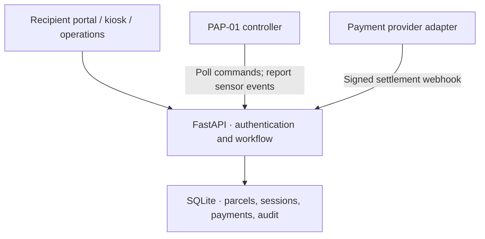
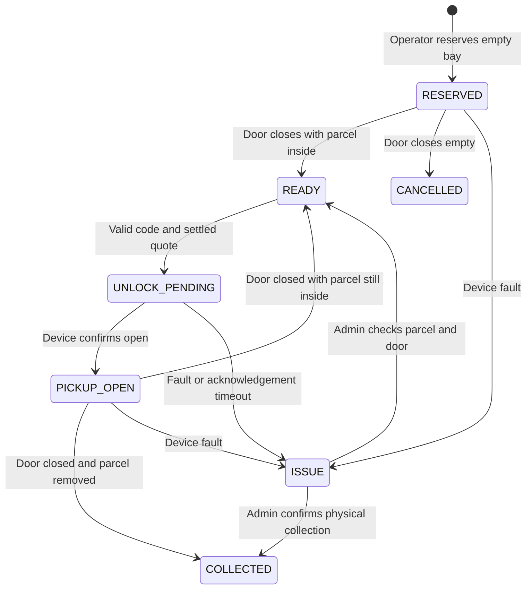

# Architecture

ParcelHub is a single-station web application. One FastAPI process serves the frontend and API. An optional Telegram worker handles private-chat orders and delivery through the same shared order service. SQLite stores operational records; a one-minute background task handles overdue reminders, expiration and stalled device commands. Currency is integer MYR sen and timestamps are UTC epoch seconds. Displays and daily totals use Asia/Kuala_Lumpur.

## Ownership and access

- Public: station capacity without recipient details, health, login/register, and kiosk code validation.
- Recipient: only that user's orders, parcels, current code/reissue and notifications. Registration always creates a recipient. Operator/admin roles are created through an authenticated admin endpoint.
- Operator: incoming order notifications, atomic task claims and assigned storage, parcel registration, recipient lookup, operations overview, reminders and counter payment confirmation.
- Admin: operator functions plus user creation, maintenance, audited incident recovery and CSV export.
- Device: a dedicated token can only poll locker commands and report door events. It cannot read account data or choose arbitrary GPIO pins through this API.
- Payment adapter: a separate HMAC secret verifies exact amount, reference, currency and timestamp. Event IDs are deduplicated.

Sessions use opaque random tokens stored as keyed hashes in SQLite, HttpOnly cookies, SameSite=Strict, and CSRF headers on authenticated writes. Production enables Secure cookies. Passwords use salted scrypt. Collection codes are verified with keyed hashes. A per-parcel random nonce plus the separate APP_SECRET derives the current OTP/QR with domain-separated HMAC, allowing the same credential to be shown on web and Telegram without storing it in plaintext. Opaque QR tokens contain no personal details. Only the owner can retrieve or replace codes; staff cannot display them.

## Order lifecycle

A recipient creates a pending request without reserving a bay. One worker atomically claims it; only that worker starts storage. The order links to one parcel and follows the parcel lifecycle below after fulfillment starts. Cancellation before acceptance and staff rejection preserve their reason/history. Empty initial deposits return the order to accepted for retry. Notifications and Telegram outbox entries commit with the order mutation. See [orders](ORDERS.md) for endpoints and state mapping.

## Parcel lifecycle

The simulator uses the same state transitions as the device API. A command is not successful merely because HTTP returned 200. Collection is recorded only after a close event with `parcel_present=false` or an explicitly audited admin recovery.

Transactions use `BEGIN IMMEDIATE` and unique partial indexes to prevent two active parcels or commands sharing a bay. Concurrent reservations receive one successful response and one conflict. Delivery, payment and state changes roll back together on failure.

## Payment contract

A validated collection code creates a random, ten-minute pickup session with a frozen quote. The client cannot submit prices or manipulate balances. Creating a payment intent does not pay it. Demo settlements require `DEMO_MODE=true`; counter settlements require an operator/admin; webhook settlements require a valid HMAC. Settling an intent twice is idempotent. Competing pending intents for the same parcel are cancelled after settlement.

Expired or cancelled intents are not auto-credited by a late webhook. The adapter must reconcile such payments with the provider/operator. There is no automated refund workflow.

## Measurements

- Occupancy, counts, revenue and activity derive from database records.
- Pickup duration measures from unlock request to confirmed closure. It is not the total customer journey or physical retrieval alone.
- Demo timings measure human interaction with the simulator and are explicitly labelled.
- There is no ROI calculator or invented performance data.

## Scope

SQLite and a single worker are deliberate for a small, single-host pilot. Multi-station tenancy, high-availability control, campus SSO, verified email/phone ownership, automated refunds, parcel returns, VIP billing, advertising and notification delivery other than Telegram are outside this version. Add migrations before changing schema in a retained installation; do not edit deployed tables ad hoc.
